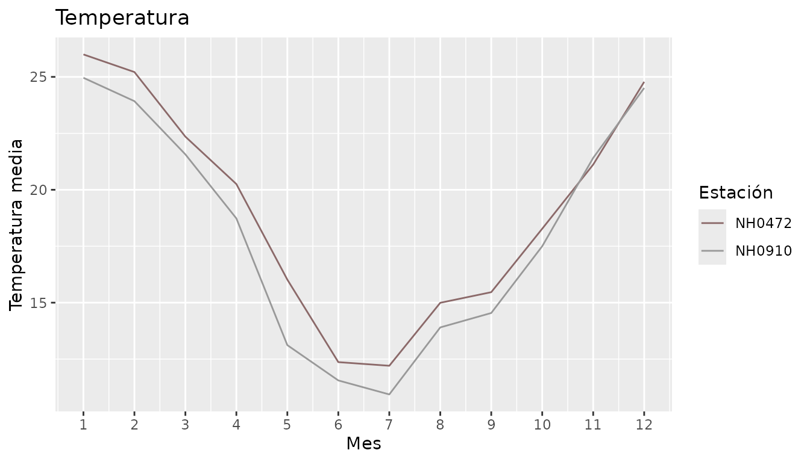
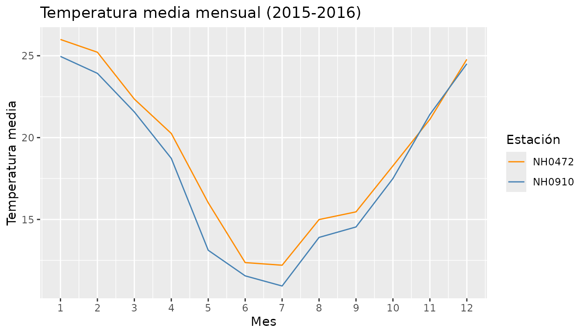
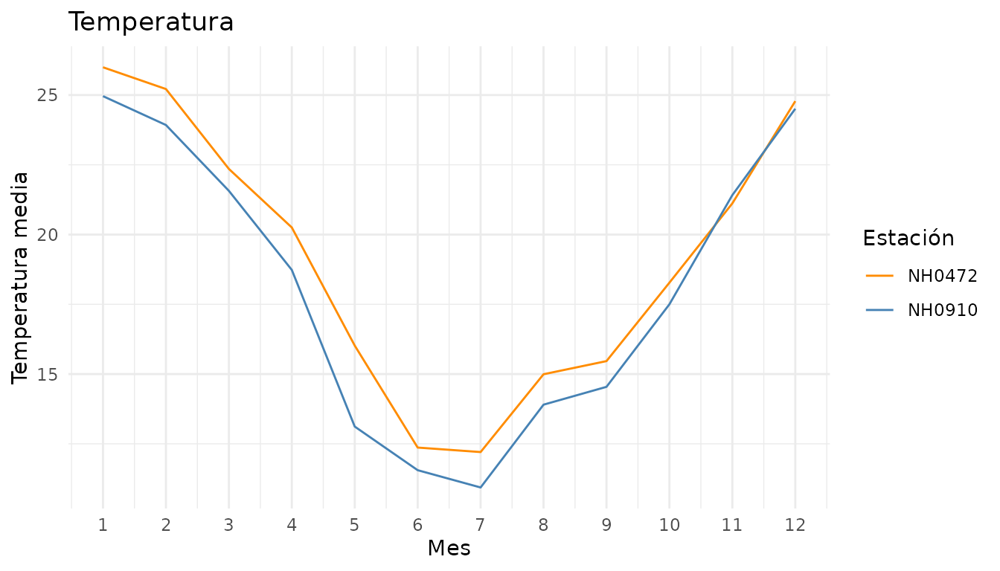

# Introducción a ElNino

En esta viñeta mostramos cómo usar las cuatro funciones del paquete con
un ejemplo completo.

``` r

library(ElNino)
```

## 1. Leer los datos

La función
[`leer_estacion()`](https://lucas2877.github.io/ElNino/reference/leer_estacion.md)
descarga los datos de una estación a partir de su `id`. Como necesita
internet, en esta viñeta no la corremos, pero se usa así:

``` r

nh0472 <- leer_estacion("NH0472")
nh0910 <- leer_estacion("NH0910")

# Para trabajar con las dos juntas las unimos una debajo de la otra
estaciones <- rbind(nh0472, nh0910)
```

Para los ejemplos usamos `estaciones_ejemplo`, que viene con el paquete.
Tiene los datos de las estaciones NH0472 y NH0910 para los años 2015 y
2016.

``` r

head(estaciones_ejemplo)
#> # A tibble: 6 × 7
#>   id     fecha      temperatura_abrigo_150cm temperatura_abrigo_150cm_maxima
#>   <chr>  <date>                        <dbl>                           <dbl>
#> 1 NH0472 2015-01-01                     19.9                            23.8
#> 2 NH0472 2015-01-02                     18.8                            26.5
#> 3 NH0472 2015-01-03                     20.7                            30.2
#> 4 NH0472 2015-01-04                     23.4                            32  
#> 5 NH0472 2015-01-05                     26.9                            34.8
#> 6 NH0472 2015-01-06                     29.6                            37  
#> # ℹ 3 more variables: temperatura_abrigo_150cm_minima <dbl>,
#> #   precipitacion_pluviometrica <dbl>, humedad_media_8_14_20 <dbl>
```

## 2. Tabla resumen de la temperatura

[`tabla_resumen_temperatura()`](https://lucas2877.github.io/ElNino/reference/tabla_resumen_temperatura.md)
calcula el promedio y el desvío estándar de la temperatura de cada
estación. Los estadísticos quedan en las filas y las estaciones en las
columnas.

``` r

tabla_resumen_temperatura(estaciones_ejemplo)
#> # A tibble: 2 × 3
#>   estadistico NH0472 NH0910
#>   <chr>        <dbl>  <dbl>
#> 1 promedio     19.1   18.2 
#> 2 desvio        5.74   6.09
```

## 3. Precipitación de cada mes

[`precipitacion_mensual()`](https://lucas2877.github.io/ElNino/reference/precipitacion_mensual.md)
suma la lluvia de todos los días de cada mes, para cada estación. La
columna `mes` tiene el primer día de cada mes.

``` r

precipitacion <- precipitacion_mensual(estaciones_ejemplo)
head(precipitacion)
#> # A tibble: 6 × 3
#>   id     mes        precip_acumulada_mensual
#>   <chr>  <date>                        <dbl>
#> 1 NH0472 2015-01-01                    221  
#> 2 NH0472 2015-02-01                     99  
#> 3 NH0472 2015-03-01                    125. 
#> 4 NH0472 2015-04-01                     66.6
#> 5 NH0472 2015-05-01                    156  
#> 6 NH0472 2015-06-01                     69.5
```

Por ejemplo, podemos ver cuál fue el mes más lluvioso de cada estación:

``` r

precipitacion |>
  dplyr::group_by(id) |>
  dplyr::filter(precip_acumulada_mensual == max(precip_acumulada_mensual))
#> # A tibble: 2 × 3
#> # Groups:   id [2]
#>   id     mes        precip_acumulada_mensual
#>   <chr>  <date>                        <dbl>
#> 1 NH0472 2016-02-01                     390.
#> 2 NH0910 2016-02-01                     292
```

## 4. Gráfico de la temperatura mensual

[`grafico_temperatura_mensual()`](https://lucas2877.github.io/ElNino/reference/grafico_temperatura_mensual.md)
grafica la temperatura media de cada mes. Si no le pasamos colores, los
elige al azar (usamos [`set.seed()`](https://rdrr.io/r/base/Random.html)
para que siempre salgan los mismos).

``` r

set.seed(42)
grafico_temperatura_mensual(estaciones_ejemplo)
```



También podemos elegir los colores y el título:

``` r

grafico_temperatura_mensual(
  estaciones_ejemplo,
  colores = c("darkorange", "steelblue"),
  titulo = "Temperatura media mensual (2015-2016)"
)
```



Como devuelve un gráfico de ggplot2, se le pueden sumar más capas:

``` r

grafico_temperatura_mensual(estaciones_ejemplo, colores = c("darkorange", "steelblue")) +
  ggplot2::theme_minimal()
```


